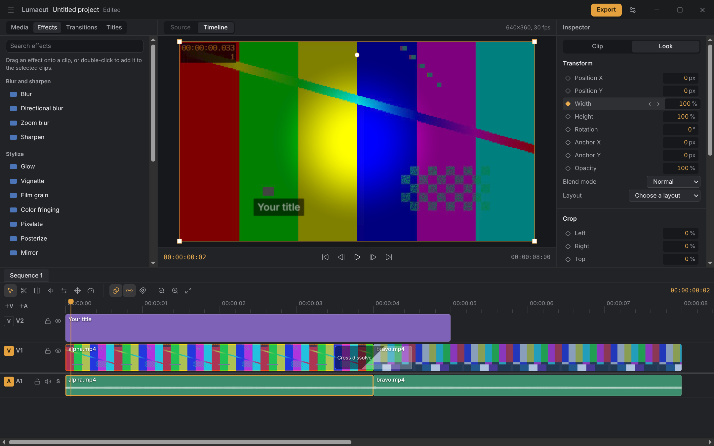
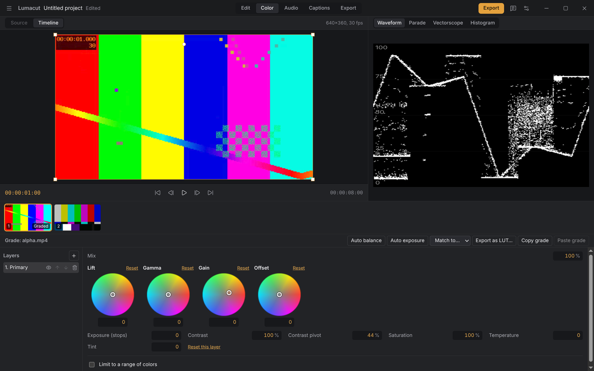
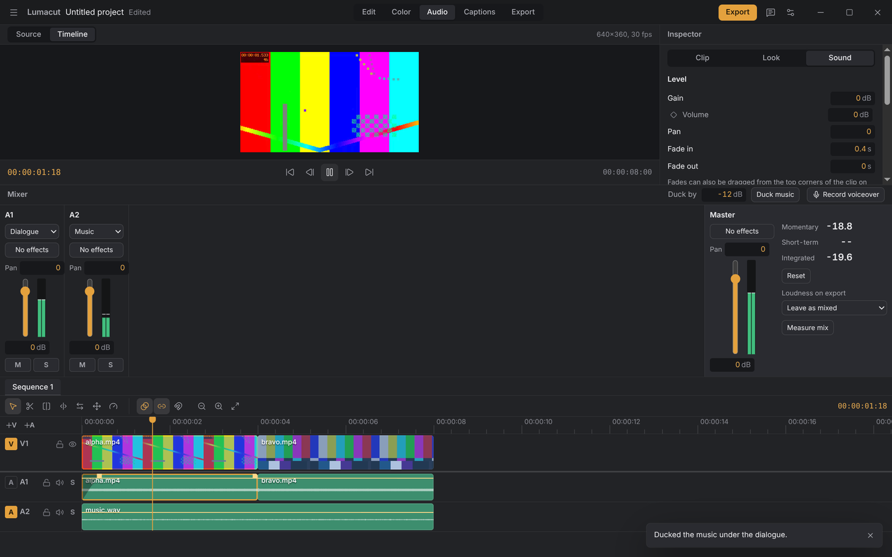
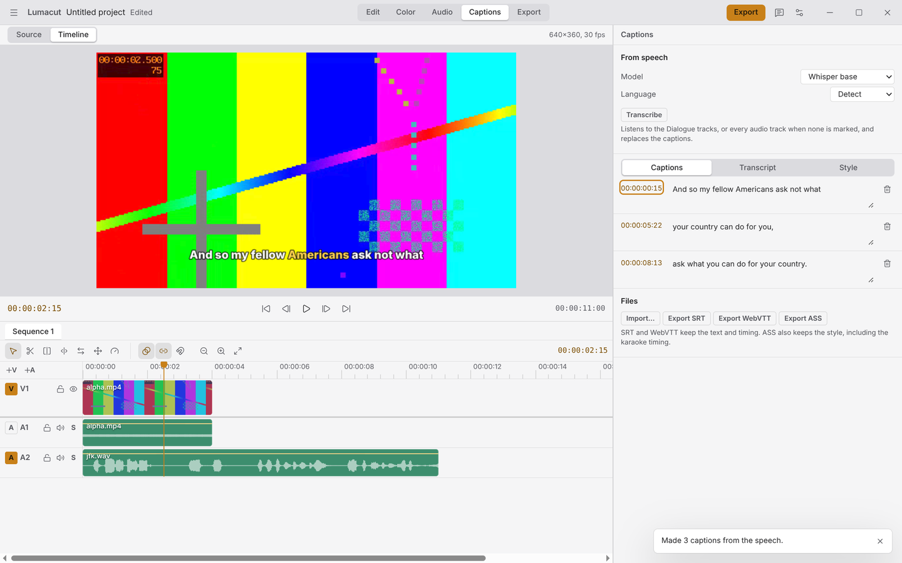
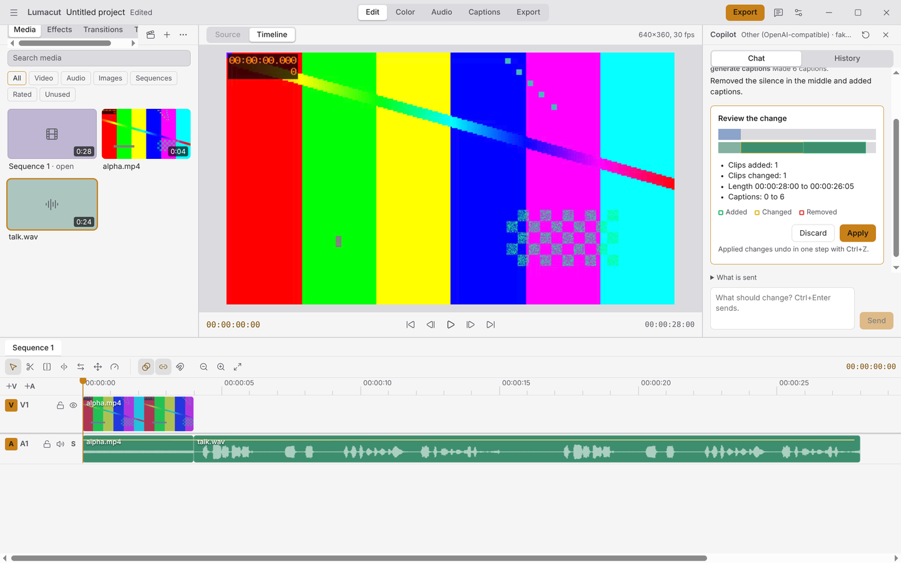
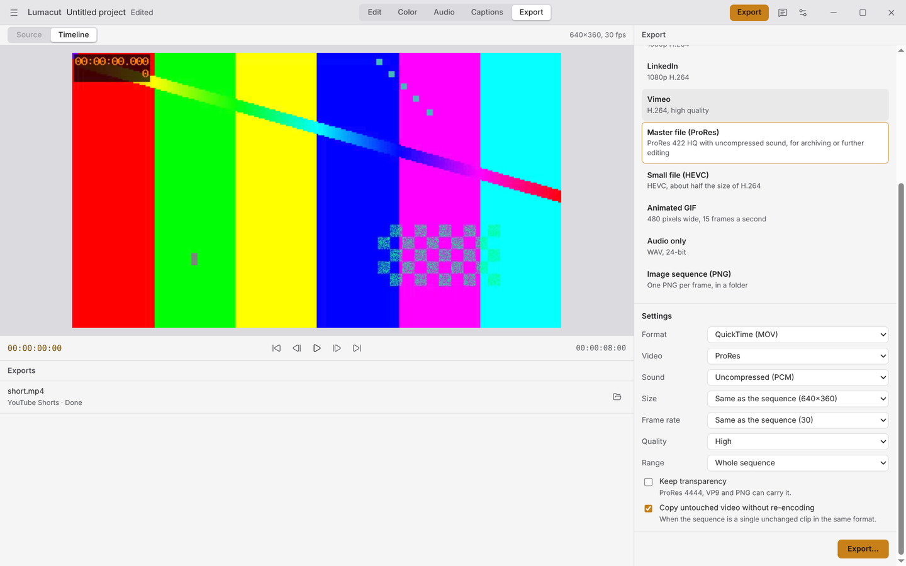

# Lumacut

A free video editor for Linux, Windows and macOS. No account, no watermark, no paid tier.

## Download

Get it from [the latest release](https://github.com/Pascalllllll/Lumacut-video-editor-/releases/latest):

| OS                                | File                                                                     |
| --------------------------------- | ------------------------------------------------------------------------ |
| Debian, Ubuntu                    | `Lumacut_<version>_amd64.deb` or `_arm64.deb`                            |
| Fedora, openSUSE                  | `Lumacut-<version>.x86_64.rpm` or `.aarch64.rpm`                         |
| Any Linux                         | `Lumacut-<version>-x86_64.AppImage` or `-arm64.AppImage`                 |
| Any Linux with Flatpak            | the `.flatpak` file, then `flatpak install --user <file>`                |
| Windows 10 and 11 (x64 and Arm)   | `Lumacut-Setup-<version>.exe`, or the portable `.exe` for your processor |
| macOS 12 and later, Apple silicon | `Lumacut-<version>-arm64.dmg`                                            |
| macOS 12 and later, Intel         | `Lumacut-<version>-x64.dmg`                                              |

Each release includes `SHA256SUMS.txt` so you can check your download.

The Windows and macOS builds aren't signed yet. Windows shows a SmartScreen warning: choose **More info**, then **Run anyway**. On macOS, open the app once with right-click and **Open**, or allow it in **System Settings > Privacy & Security**.

Lumacut can update itself as an AppImage or from the Windows installer. Other packages show when a new version is out, and you install it the way you installed Lumacut. **Settings > Updates** turns checking off.

## What works today

- Import video, audio and images by button or by dropping files
- Edit on as many video and audio tracks as you need, with lock, hide, mute and solo
- Tools for cutting and trimming: blade, ripple, roll, slip, slide and rate stretch, plus a magnetic mode that keeps the main track gap-free
- Three- and four-point editing from a source viewer: insert, overwrite, replace and fit to fill
- Markers, in and out points, J/K/L playback
- Speed changes, reverse, hold frames and speed ramps, with optional frame blending or optical flow on export
- Compound clips, nested sequences and multicam clips synced by sound
- Effects, keyframes with a curve editor, masks, blend modes, picture-in-picture and split screens
- Transitions, titles with animations, color clips and adjustment layers
- Tracking and stabilization
- Color grading in a color workspace: wheels, curves, hue curves, LUTs, color qualifiers, auto balance and shot matching
- Waveform, RGB parade, vectorscope and histogram
- Color management for Rec. 709, P3 and Rec. 2020, and HDR export in PQ or HLG
- A mixer with meters and loudness readings, sound effects on clips and tracks, fades and volume keyframes
- Exports at -14, -16 or -23 LUFS, music ducking under dialogue, beat markers and voiceover recording
- Captions from speech, on your computer, with styles, karaoke highlighting and SRT, WebVTT and ASS files
- Edit by text, remove silences and filler words, cut at scene changes
- Voice cleanup and background removal, also on your computer
- A copilot that edits from plain requests, with every change shown before it is applied and undone in one step; your own key or a local model
- A local MCP server so other AI tools can work with the open project
- Export presets for the main platforms, ProRes, DNxHR, AV1, VP9, GIF, audio only and image sequences, with hardware encoding and a background queue
- A command palette, shortcut presets for Premiere Pro, Final Cut Pro and DaVinci Resolve, and resizable panels
- Proxies for smooth playback of 4K and formats the viewer can't play
- Undo for every edit, autosave, and recovery after a crash
- Save and open `.lumacut` project files
- Export to H.264 MP4 at the sequence's size and frame rate, with no watermark and no size limit
- Light and dark themes, six accent colors, interface size from 90% to 150%
- Packages for Linux (deb, rpm, AppImage, Flatpak, tar.gz), Windows and macOS, with updates and a What's new sheet
- A start screen with recent projects, a short guided tour, and optional sign-in with Google

## Screenshots

|                                                                                                             |                                                                                                                  |
| ----------------------------------------------------------------------------------------------------------- | ---------------------------------------------------------------------------------------------------------------- |
|               |  |
| Color: wheels, curves, LUTs and scopes                                                                      | Audio: mixer, meters and loudness                                                                                |
|     |    |
| Captions from speech, made on your computer                                                                 | Copilot changes wait for your review                                                                             |
|  |                                                                                                                  |
| Export presets, codecs and the queue                                                                        |                                                                                                                  |

## What it's for

Lumacut aims to cover what people usually pay for in a video editor: multi-track editing, color grading with scopes, audio mixing with loudness targets, captions from speech, and exports up to 8K with hardware encoding. Everything runs on your computer. AI features are optional: local models work offline, and cloud models use your own API key.

## Privacy

Lumacut sends nothing anywhere unless you choose a cloud AI provider for the copilot, and local-only mode blocks even that. The update check asks GitHub for the newest version number and can be turned off. Signing in with Google is optional: Lumacut reads only your name, email address and picture, revokes its access right away, and keeps nothing else. There's no telemetry and no account.

## License

GPL-3.0-or-later. See [LICENSE](LICENSE) and [THIRD_PARTY_NOTICES.md](THIRD_PARTY_NOTICES.md).

## Changelog

### 1.0.0

The first release.

- Packages for Windows (x64 and Arm) and macOS (Apple silicon and Intel), and a Flatpak for Linux.
- A start screen with recent projects, a guided tour, and optional Google sign-in.
- Security hardening of the window, project files and media.
- Updates: install them by themselves, only be told, or never check; a What's new sheet after each update.
- Export workspace with presets, more codecs, hardware encoding and a queue.
- Command palette, shortcut presets, resizable panels, media ratings, tags, relinking and collecting.
- Copilot with reviewed, one-step changes; eight providers including local ones; local-only mode.
- Local MCP server for other AI tools.
- Captions from speech with local models, caption styles, and SRT, WebVTT and ASS files.
- Edit by text, silence and filler-word removal, scene cuts, voice cleanup and background removal, all offline.
- Audio workspace: mixer, meters, loudness readings, and sound effects on clips, tracks and the master.
- Fades, volume keyframes, loudness targets on export, ducking, beat markers and voiceover recording.
- Color workspace: layered grades with wheels, curves, LUTs and qualifiers, eight looks, auto balance and shot matching.
- Waveform, parade, vectorscope and histogram.
- Color management and HDR export.
- Effects, keyframes and a curve editor, masks, blend modes, layouts, and on-picture controls.
- Transitions, animated titles, color clips and adjustment layers.
- Tracking and stabilization; effect presets.
- Multi-track editing with linked picture and sound, and lock, hide, mute and solo per track.
- Blade, ripple, roll, slip, slide and rate stretch tools, ripple delete, and a magnetic timeline.
- Source viewer with in and out marks; insert, overwrite, replace, fit to fill, lift and extract.
- Markers, J/K/L playback, jumping between cuts.
- Speed, reverse, hold frames, speed ramps, frame blending and optical flow.
- Compound clips, nested sequences, and multicam clips synced by sound.
- Proxies, autosave and crash recovery.
- Import, timeline editing, playback, `.lumacut` project files and H.264 MP4 export.
- Settings for theme, accent color and interface size; Linux packages.

Full history in [CHANGELOG.md](CHANGELOG.md).
